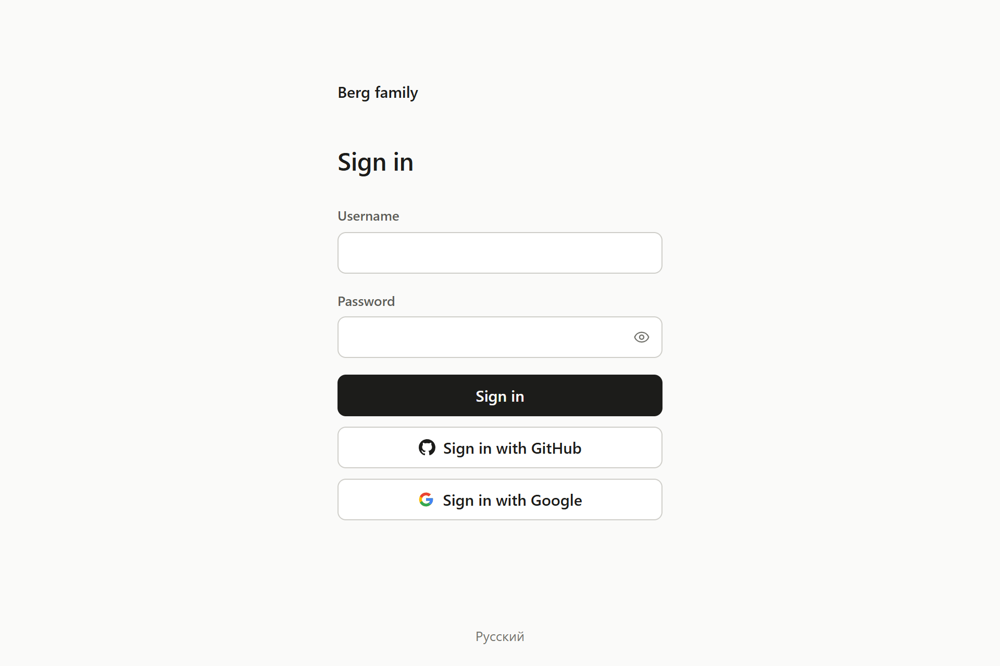
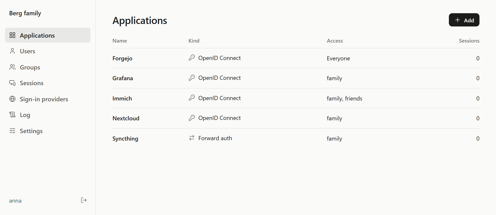

# Unlatch

[](https://github.com/Romanok2805/unlatch/actions/workflows/ci.yml)
[](https://crates.io/crates/unlatch)
[](https://crates.io/crates/unlatch)
[](https://unlatch.dev)
[](LICENSE)

Unlatch is a single sign-on server you host yourself. It speaks OpenID Connect, so people sign in
once and can then use every service you connect to it, such as Grafana, Forgejo or Nextcloud. It is
written in Rust with few dependencies and runs as one 9 MB binary with one SQLite file, in
[about 7 MB of memory](docs/architecture.md#memory).

Unlatch is young: it hasn't been audited or certified yet. [The comparison](docs/comparison.md)
shows how it differs from Authelia, authentik, Kanidm, Pocket ID and Rauthy.





## Features

- Sign-in with a passkey, with a password and a code from an authenticator app, or with Google,
  GitHub and other OpenID providers.
- OpenID Connect for applications that support it.
- Forward authentication through nginx, Traefik or Caddy for applications that don't.
- A web interface for applications, users, groups, sessions and sign-in providers.

## Getting started

Download [a release](https://github.com/Romanok2805/unlatch/releases),
install it with `cargo install --locked unlatch`, or build it with `cargo build --release`.
To try it on this machine:

```sh
(umask 077; unlatch generate-key > key)
UNLATCH_ISSUER=http://localhost:8080 UNLATCH_KEY_FILE=key unlatch
```

Or with Docker:

```sh
docker run --rm ghcr.io/romanok2805/unlatch generate-key > key
docker run --rm -p 127.0.0.1:8080:8080 -e UNLATCH_ISSUER=http://localhost:8080 \
  -e UNLATCH_KEY_FILE=/key -v "$PWD/key:/key:ro" ghcr.io/romanok2805/unlatch
```

Then open the link from the log, which creates the first administrator.
The administrator then [connects applications](docs/applications.md)
and [invites people](docs/users.md) in the web interface.
[Running Unlatch](docs/running.md) shows how to run it on a server, with systemd or Docker Compose.

## Documentation

- [Running Unlatch](docs/running.md): releases, systemd, containers, reverse proxy and backups.
- [Configuration](docs/configuration.md): every setting.
- [Connecting applications](docs/applications.md): OpenID Connect settings, what applications
  learn about users, and examples for Forgejo, Grafana, Immich, Nextcloud, Proxmox VE and
  Vaultwarden.
- [Users and groups](docs/users.md): invitations, lost passwords and access by group.
- [Sign-in providers](docs/providers.md): signing in with Google, GitHub and others.
- [Forward authentication](docs/forward-auth.md): protecting services without OpenID Connect.
- [Comparison](docs/comparison.md): Unlatch next to other servers you can host yourself.
- [Changes](CHANGELOG.md)

## Development

- [Architecture](docs/architecture.md): how Unlatch works, why, and what is left out on purpose.
- [Threat model](docs/threat-model.md): what it protects against and what it doesn't.
- [Conformance](conformance/README.md): results of the OpenID Foundation's test suite.
- [Contributing](CONTRIBUTING.md)
- [Reporting a vulnerability](SECURITY.md)

## License

[MIT](LICENSE)
